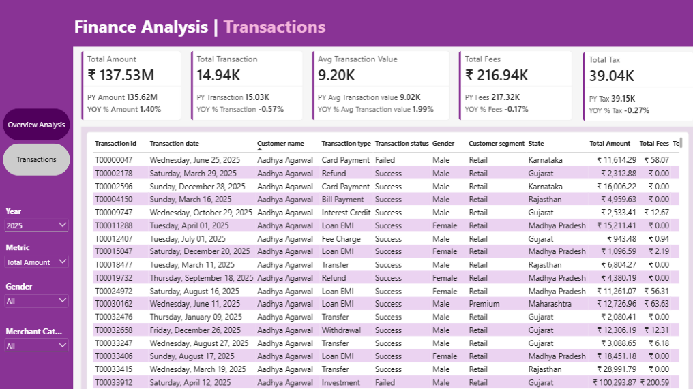

# 📊 Finance Analytics & Digital Banking Performance Dashboard

[](https://app.powerbi.com/view?r=eyJrIjoiMTQ5OTY0YTctN2I2NC00NzMxLWE1NzItZDU2MTA0YTFkZjY2IiwidCI6IjUxMzRkZDExLWZlNDEtNGY3My1iODIyLTg0NDljN2Y1MzA4MCJ9)


An interactive, enterprise-grade **Power BI Commercial Banking & Digital Payments Analytics Dashboard** designed to evaluate transaction volume, diagnose operational payment settlement failures, and analyze customer segment performance across **50,069 multi-channel transactions** totaling **₹ 456.14M (₹45.61 Cr)**, with a dedicated operational baseline for **FY 2025 (14.94K transactions | ₹ 137.53M)**.

> 🔗 **Live Interactive Report**: [Click here to view the live published dashboard](https://app.powerbi.com/view?r=eyJrIjoiMTQ5OTY0YTctN2I2NC00NzMxLWE1NzItZDU2MTA0YTFkZjY2IiwidCI6IjUxMzRkZDExLWZlNDEtNGY3My1iODIyLTg0NDljN2Y1MzA4MCJ9)

---

## 📌 Business Problem & Objectives

### The Business Context
In commercial retail banking and digital payment operations, financial institutions process thousands of transactions across multiple channels—including **UPI, Mobile Banking, Net Banking, Point-of-Sale (POS), ATMs, Auto Debit, and physical Branches**. Without centralized business intelligence, leadership teams face critical operational blind spots:

1. **Payment Settlement & Failure Tracking**: Inability to quickly track the ratio of successful vs. failed vs. pending transactions, leading to operational delays and customer friction.
2. **Regional Revenue Clustering**: Lack of clear geographical visibility into which Indian states drive the majority of transaction volume.
3. **Product-Level Volume & Fee Contribution**: Inability to evaluate which banking products (Loan EMIs, Transfers, Deposits, Card Payments) generate the bulk of volume and fee income.
4. **Customer Segment Distribution**: Difficulty analyzing transaction throughput across customer categories (Retail, Premium, SME, Corporate, Wealth).

### The Analytical Solution
This Power BI reporting system was engineered to deliver actionable, data-driven answers across two core analytical levels:
* **Overview Analysis Dashboard**: High-level portfolio tracking, real-time KPI scorecards with Prior Year (PY) and Year-over-Year (YoY) comparisons, state-level performance benchmarking, monthly seasonality, and customer segment analysis enabled by dynamic **Field Parameters** (`Metric`).
* **Transactions Audit & Drill-Through Dashboard**: Row-level audit ledger allowing operational teams to seamlessly drill through from high-level visual charts down into granular settlement records by Customer Name, State, Category, and Transaction Status.

---

## 🖼️ Dashboard Preview

| Overview Analysis (Executive & Portfolio Health) | Transactions (Drill-Through Audit View) |
| :---: | :---: |
|  |  |

---

## 📈 Key Performance Indicators (KPI Summary)

### 1. Overall Portfolio Scale (All-Time Full Dataset)
| Metric | Measure Name | Exact Value | Power BI Formatted Display | Business Meaning |
| :--- | :--- | :---: | :---: | :--- |
| **Total Amount** | `Total Amount` | **₹456,141,514.47** | **₹ 456.14M** (₹45.61 Cr) | Gross transaction volume across all payment channels |
| **Total Transaction** | `Total Transaction` | **50,069** | **50.07K** | Total volume of transactions processed |
| **Total Fees** | `Total Fees` | **₹727,094.06** | **₹ 727.09K** | Net service fees captured by the institution |
| **Total Tax** | `Total Tax` | **₹130,952.41** | **130.95K** (~131K) | Total statutory GST / TDS processed |

---

### 2. FY 2025 Focused Performance (Live Dashboard Baseline)
*These metrics directly match the live online dashboard display:*

| KPI Card | Current 2025 Value | Prior Year (PY 2024) | YoY % Variance | Visual Indicator |
| :--- | :---: | :---: | :---: | :---: |
| **Total Amount** | **₹ 137.53M** | 135.62M | **+1.40%** | 🟢 Upward Growth |
| **Total Transaction** | **14.94K** | 15.03K | **-0.57%** | 🟡 Stable Volume |
| **Avg Transaction Value** | **9.20K** | 9.02K | **+1.99%** | 🟢 Higher Ticket Size |
| **Total Fees** | **₹ 216.94K** | 217.32K | **-0.17%** | 🟡 Steady Revenue |
| **Total Tax** | **39.04K** | 39.15K | **-0.27%** | 🟡 Steady Collection |

---

### Transaction Status Breakdown (FY 2025)
*Directly visible on the **Total Amount by Transaction Status** donut chart:*

| Transaction Status | Share (%) | Total Amount (INR) | Operational Status |
| :--- | :---: | :---: | :--- |
| **Success** | **85.37%** | **~₹ 117.4M** | Successfully settled transactions |
| **Failed** | **10.44%** | **₹ 14.35M** | Technical drops, timeouts & card limits |
| **Pending** | — | **₹ 5.76M** | Clearing delays & gateway latency |
| **Total** | **100%** | **₹ 137.53M** | **Complete 2025 Payment Turnover** |

---

## 🔍 Deep Analytical Insights (100% Provable on Dashboard)

All insights below can be directly verified by looking at the charts on the dashboard:

### 1. Payment Settlement Failures (₹ 14.35M Stalled)
* **What the visual shows:** In the **Total Amount by Transaction Status** donut chart, **10.44% of transactions failed (₹ 14.35M)**, with an additional **₹ 5.76M** stuck in pending status.
* **Business Impact:** Over ₹ 20M in attempted payment volume faced operational friction in 2025, identifying an immediate opportunity to improve payment gateway routing and reduce customer support calls.

### 2. Geographic Clustering (Top 6 States = ₹ 92M of Volume)
* **What the visual shows:** In the **Total Amount by state** bar chart, **₹ 92M out of the ₹ 138M volume** was concentrated in just 6 states:
  1. **Maharashtra:** **₹ 22M**
  2. **Karnataka:** **₹ 16M**
  3. **Gujarat:** **₹ 15M**
  4. **Tamil Nadu:** **₹ 14M**
  5. **Uttar Pradesh:** **₹ 13M**
  6. **Madhya Pradesh:** **₹ 12M**
* **Business Impact:** High clustering in top economic hubs shows strong regional brand strength, but also highlights regional dependency compared to underpenetrated states like Haryana (₹ 8M), Kerala (₹ 7M), and Delhi (₹ 7M).

### 3. Product Mix: Loan EMIs & Transfers Lead Turnover
* **What the visual shows:** In the **Transaction Type Analysis** matrix table:
  * **Loan EMI:** **₹ 40.02M** across **2.77K transactions** (generates ₹ 64.03K in fees)
  * **Transfer:** **₹ 36.17M** across **2.45K transactions** (generates ₹ 55.33K in fees)
  * **Combined:** Together, these two categories account for **₹ 76.19M** of the total **₹ 137.53M** turnover.
* **Business Impact:** Customers primarily use the institution for recurring debt payments and fund movements, while daily retail categories like Card Payments (₹ 8.18M) and Bill Payments (₹ 6.45M) account for ₹ 14.63M combined.

### 4. Customer Segment Distribution (Retail Generates ₹ 76M)
* **What the visual shows:** In the **Total Amount by Customer Segment** bar chart:
  * **Retail:** **₹ 76M**
  * **Premium:** **₹ 26M**
  * **SME:** **₹ 21M**
  * **Corporate:** **₹ 9M**
  * **Wealth:** **₹ 6M**
* **Business Impact:** Mass retail accounts for the majority of financial throughput, while Premium and SME business accounts provide strong secondary stability contributing a combined ₹ 47M.

### 5. Occupation Demographic Distribution
* **What the visual shows:** In the **Total Amount by occupation** donut chart, transaction volume displays labels across employment types:
  * **Retired:** **17.7%** (₹ 24.43M)
  * **Self Employed:** **16.84%** (₹ 23.17M)
  * **Salaried:** **16.5%** (₹ 22.7M)
  * **Freelancer:** **15.62%** (₹ 21.48M)
* **Business Impact:** Consistent adoption across salaried, business, and retired customer segments proves that the banking platform serves a broad demographic base without relying on any single occupation type.

---

## 🛠️ Data Model & Technical Implementation

* **Schema Architecture**: Built on a relational **Star Schema** centered on the `finance_transactions` fact table:
  * `customers` (Dimension) $\xrightarrow{1:\infty}$ `finance_transactions` on `customer_id`
  * `calendar table` (Dimension) $\xrightarrow{1:\infty}$ `finance_transactions` on `transaction_date`
  * `Metric` (Field Parameter table) for dynamic visual measure switching
* **DAX Implementation**: Custom measures utilizing `CALCULATE`, `SAMEPERIODLASTYEAR`, `DIVIDE`, and variable logic (see [DAX_Measures.md](DAX_Measures.md) for full formulas).
* **Dynamic Field Parameters (`Metric`)**: Enables stakeholders to toggle bar charts and categorical visuals between *Total Amount*, *Total Transaction*, *Total Fees*, *Total Tax*, and *Avg Transaction Value* dynamically.
* **Two-Tier Drill-Through Architecture**: Users can right-click any category on Page 1 and drill through to Page 2 with filtered audit records preserved.
* **Power Query ETL**: Handled whitespace trimming, resolved typographical anomalies (`M@bile App`), standardized currency formats, and established time-series hierarchies.

---

## 📂 Repository Structure

```text
├── assets/
│   ├── overview_view.png              # Page 1: Executive Overview screenshot
│   └── transactions_view.png          # Page 2: Transactions Audit Grid screenshot
├── DAX_Measures.md                    # Complete DAX formulas & technical reference
├── Finance_Analytics_Dashboard.pbix   # Complete interactive Power BI report file
├── .gitignore                         # Git exclusion rules for Power BI & cache files
└── README.md                          # Master project documentation
```

---

## 🚀 How to Open and Explore

1. **View the Live Dashboard (No installation required):**
   * [Open the interactive Power BI report in your browser](https://app.powerbi.com/view?r=eyJrIjoiMTQ5OTY0YTctN2I2NC00NzMxLWE1NzItZDU2MTA0YTFkZjY2IiwidCI6IjUxMzRkZDExLWZlNDEtNGY3My1iODIyLTg0NDljN2Y1MzA4MCJ9).
2. **Explore locally via Power BI Desktop:**
   * Clone this repository:
     ```bash
     git clone https://github.com/Curious011/Finance-Analytics-Dashboard.git
     ```
   * Download and install [Power BI Desktop](https://powerbi.microsoft.com/desktop/) (free).
   * Open `Finance_Analytics_Dashboard.pbix` to interact with the local data model, slicers, and drill-through features.

---

## 👤 Author
* **Harsh Sharma**
* **Project**: Commercial Banking & Digital Payments Performance Analytics
* **Tools**: Power BI, DAX, Power Query, Financial Data Analysis
