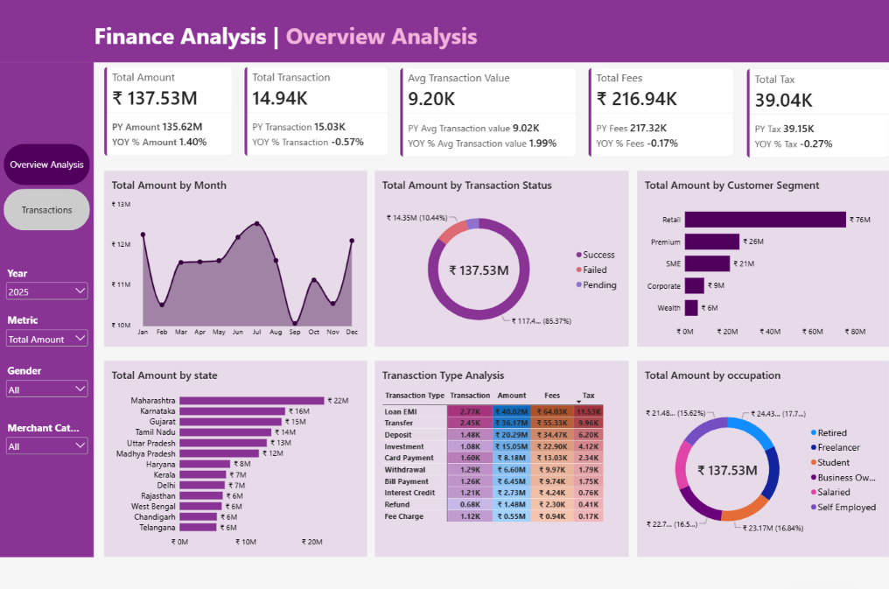

# Finance Analytics Dashboard | Power BI


An end-to-end commercial retail banking and digital payments analytics dashboard built in **Power BI**. This project analyzes **50,069 multi-channel transactions** totaling **₹45.61 Crore ($5.5M+)** across **5,000 customer accounts** to monitor financial KPIs, operational payment failures, regional concentration, and customer segment profitability.

---

## 📌 Dashboard Previews

### Page 1: Overview Analysis
*Executive summary tracking portfolio turnover, monthly trends, state performance, transaction status, customer segments, and occupation demographics with dynamic Field Parameters.*



### Page 2: Transactions (Drill-Through Audit View)
*Detailed transaction audit ledger providing row-level drill-through capabilities from high-level KPI cards down to individual settlement records.*


---

## 🎯 Business Problem & Objectives

A commercial financial institution processing multi-channel transactions (UPI, Mobile Banking, Net Banking, Cards/POS, ATMs, and physical Branches) faced operational challenges in monitoring performance across diverse customer cohorts and regions. 

**Core Objectives:**
1. **Portfolio Monitoring:** Track total gross transaction value (GTV), transaction counts, and fee yields in real time.
2. **Operational Reliability:** Detect payment failure bottlenecks (Success vs. Failed vs. Pending) to reduce revenue leakage.
3. **Geographic & Demographic Insights:** Identify top revenue-generating Indian states, customer segments (Retail, SME, Corporate, Premium, Wealth), and occupation trends.
4. **Interactive Self-Service Reporting:** Allow executives to switch metrics dynamically (Amount, Transactions, Fees, Tax) on a single canvas using Power BI Field Parameters.

---

## 📊 Core Portfolio Metrics

| Metric | Entire Portfolio (2023–2026) | FY 2025 Focus | Business Meaning |
| :--- | :---: | :---: | :--- |
| **Gross Transaction Value (GTV)** | **₹456.14 Million** (₹45.61 Cr) | **138 Million** (137.69M) | Total monetary throughput moving across payment rails |
| **Total Transactions** | **50,069 records** | **14,964 records** (15.0K) | Total volume of executed transactions |
| **Average Transaction Value (ATV)**| **₹9,110.26** | **₹9,201.52** (9.20K) | Mean ticket size per transaction |
| **Total Fee Revenue** | **₹727,094** (~₹7.27 Lakhs) | **₹217,266** (~217.3K) | Net fee income captured by the bank (take-rate: ~0.16%) |
| **Total Tax Deductions** | **₹130,952** (~₹1.31 Lakhs) | **₹39,112** (~39.1K) | Statutory GST / TDS collected |
| **Active Customer Base** | **3,983 transacting users** | — | 79.66% active vs. 20.34% dormant (1,017 inactive accounts) |

---

## 🔍 Key Business & Data Insights

### 1. Operational Failure & Revenue Leakage
* **Baseline Failure Rate:** Across 2025, **10.4% of transactions failed (14M)** with an additional **4.2% pending (6M)**, resulting in **14.6% (20M)** of attempted capital being stalled or blocked by payment gateway bottlenecks.
* **The High-Ticket Cliff:** Transactions exceeding **₹100,000 experienced a failure rate of 19.3%**—nearly double the baseline—driven by bank limit caps, 2FA authentication timeouts, and security flags.

### 2. Geographic Concentration (Top 6 States = 67% Volume)
* In 2025, **66.9% (~67%) of total volume (92M out of 138M)** was concentrated in just 6 states:
  1. **Maharashtra:** 22M (15.8%)
  2. **Karnataka:** 16M (11.6%)
  3. **Gujarat:** 15M (11.2%)
  4. **Tamil Nadu:** 14M (10.0%)
  5. **Uttar Pradesh:** 13M (9.6%)
  6. **Madhya Pradesh:** 12M (8.7%)
* *Strategic Implication:* High market clustering in urban centers exposes the bank to regional regulatory/economic risks, while Tier-2/Tier-3 states remain heavily underpenetrated.

### 3. Product & Revenue Mix
* **Loan EMIs (₹131.1M / 28.8%)** and **Fund Transfers (₹120.9M / 26.5%)** drive **55.2% of the bank's total financial turnover**, revealing that customers treat the institution primarily for debt servicing and money movement rather than daily retail card swipes.

### 4. Customer Retention & Dormancy Gap
* **20.34% Dormancy Rate:** 1,017 out of 5,000 registered accounts had zero transactions, indicating high Customer Acquisition Cost (CAC) leakage due to a lack of post-onboarding engagement incentives.

### 5. High-Value Customer Segments
* While **Retail** drives the highest sheer volume (**54.4% of all transactions**), **Premium and SME** customers generate the highest annual value per user (**>₹1.18 Lakhs**), making them the most profitable targets for loyalty programs.

---

## 🏗️ Data Architecture & Star Schema Model

The data model is structured using an optimized **Star Schema**:

* **Fact Table:**
  * `finance_transactions` (50,069 records): Stores transaction amounts, fee amounts, tax amounts, channel, merchant category, status, and risk metrics.
* **Dimension Tables:**
  * `customers` (5,000 records): Stores customer demographics, segments, city, state, annual income, and occupation.
  * `calendar table`: Dedicated date dimension table providing month names, years, and calendar hierarchies.
  * `Metric`: DAX Field Parameter table for dynamic measure toggling.
* **Relationships:**
  * `customers[customer_id]` 1 $\rightarrow$ $\infty$ `finance_transactions[customer_id]` (Active, 1-to-Many)
  * `calendar table[Date]` 1 $\rightarrow$ $\infty$ `finance_transactions[transaction_date]` (Active, 1-to-Many)

---

## 🛠️ Advanced Technical Power BI Features

* **Dynamic Field Parameters:** Implemented `Metric.Metric` to allow users to toggle chart values dynamically between *Total Amount*, *Total Transaction*, *Total Fees*, and *Total Tax* with 1 click.
* **Interactive Drill-Through:** Built cross-report drill-through allowing executives to right-click on any visual category and jump directly into the filtered row-level audit ledger on Page 2.
* **New Card Visual (2.0):** Leveraged card visuals with **Reference Labels** displaying Prior Year (PY) metrics and YoY percentage variances automatically.
* **ETL Data Cleaning (Power Query):** Handled channel typographic artifacts, trimmed leading/trailing whitespaces, standardized currency codes (`INR`), and converted dates into clean time-series hierarchies.

---

## 📂 Repository Structure

```text
Finance-Analytics-Dashboard/
│
├── Finance_Analytics_Dashboard.pbix   # Main Power BI Desktop Report File
├── README.md                          # Project Documentation & Insights
├── .gitignore                         # Git exclusion rules
│
├── data/
│   ├── customers.csv                  # Customer demographic dataset (5,000 records)
│   ├── finance_transactions.csv       # Multi-channel transaction records (50,069 records)
│   └── Data_Dictionary.md             # Field-by-field column definitions
│
├── docs/
│   └── DAX_Measures.md                # Comprehensive catalog of DAX formulas
│
└── images/
    ├── dashboard_overview.png         # Screenshot of Page 1
    └── dashboard_transactions.png     # Screenshot of Page 2
```

---

## 🚀 How to Open and View this Project

1. **Clone this repository:**
   ```bash
   git clone https://github.com/<your-username>/Finance-Analytics-Dashboard.git
   ```
2. **Open the Power BI file:**
   * Download and install [Power BI Desktop](https://powerbi.microsoft.com/desktop/) (Free).
   * Double-click `Finance_Analytics_Dashboard.pbix` to open and explore the interactive report.

---

## 👤 Author
* **Project:** Finance Analytics Dashboard
* **Tools:** Power BI Desktop | DAX | Power Query | Excel / CSV | Git
